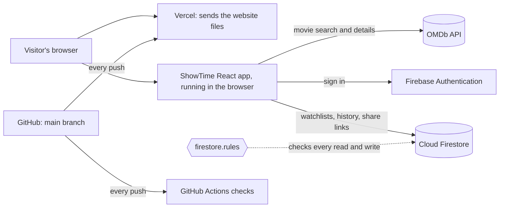
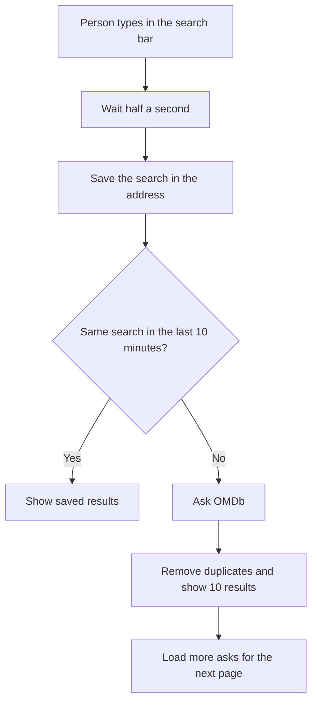
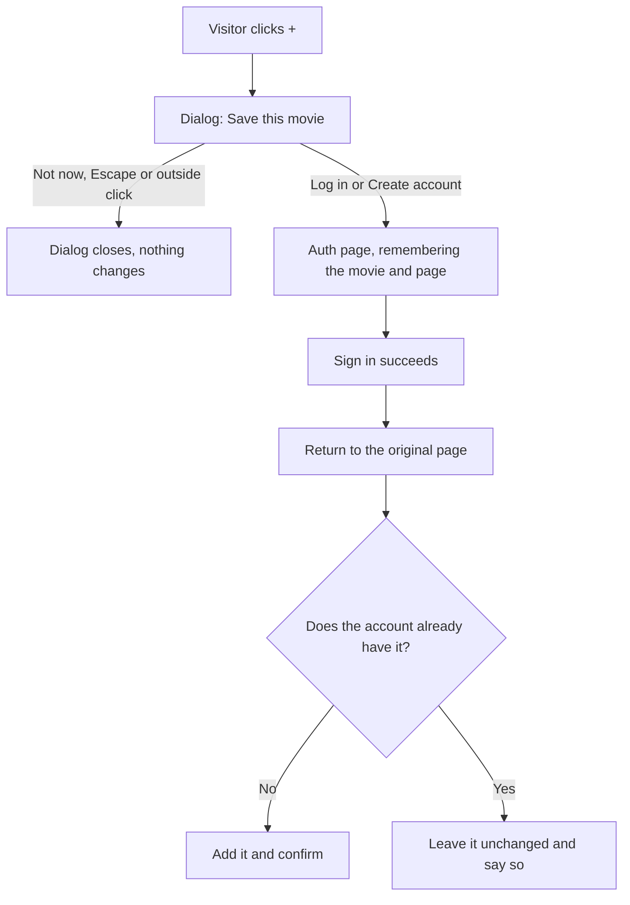
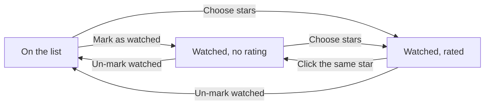
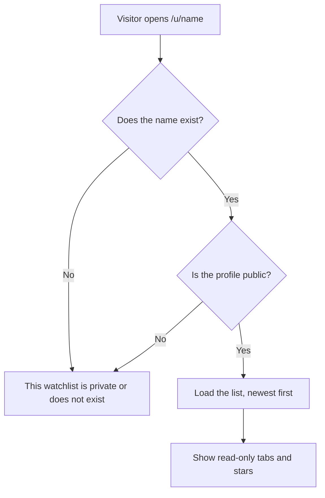
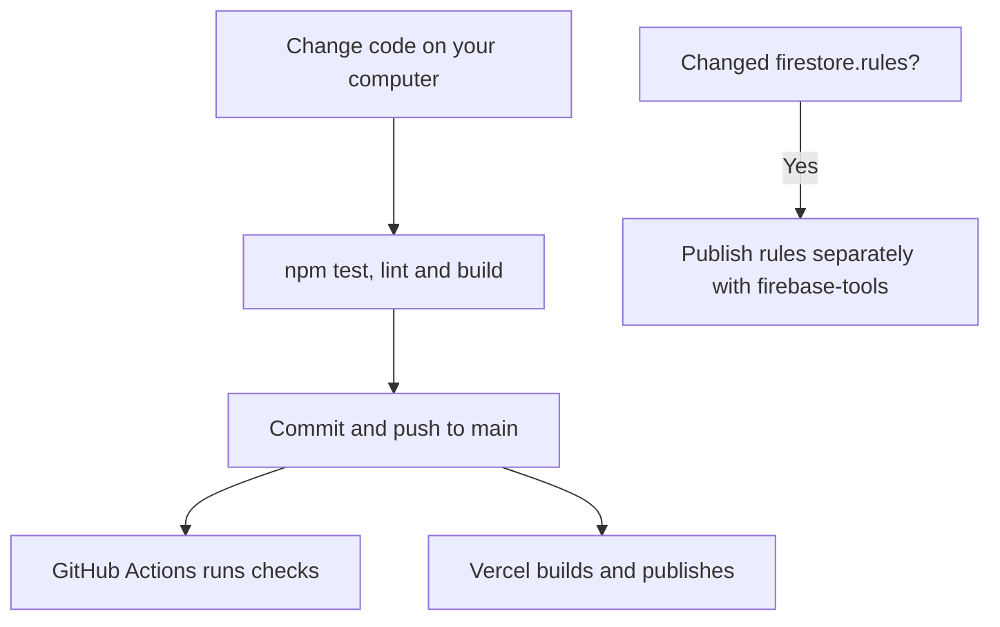

# ShowTime: the owner's guide

This is the one file to read if you come back to ShowTime after months or years and need to remember
everything: what it is, how it is built, what every feature does, where it runs, how to change it,
and what to do when something breaks.

It is written for you, the owner, in plain English. `README.md` is the public description of the app
and `AGENTS.md` is the instruction sheet for AI coding tools. This guide is the full story.

The flowcharts appear as pictures when you open this file on GitHub, or in VS Code with a Mermaid
preview extension. Anywhere else they still read as simple text.

**Snapshot:** written on 18 November 2026 at commit `2160856`. The app had about 4,900 lines of
JavaScript including tests, and 185 app tests in 20 files, all passing. GitHub's checks, including
the security rules tests, had passed on that commit. Things may have changed since, so trust the code
when it disagrees with this file.

## Contents

1. [ShowTime in one page](#1-showtime-in-one-page)
2. [I want to... (quick answers)](#2-i-want-to-quick-answers)
3. [The big picture](#3-the-big-picture)
4. [Technology used, and why](#4-technology-used-and-why)
5. [Every feature, explained](#5-every-feature-explained)
6. [Every page in the app](#6-every-page-in-the-app)
7. [How things work: flowcharts](#7-how-things-work-flowcharts)
8. [The database](#8-the-database)
9. [Where the code lives](#9-where-the-code-lives)
10. [Outside services the app calls](#10-outside-services-the-app-calls)
11. [Privacy and security](#11-privacy-and-security)
12. [Limits and numbers](#12-limits-and-numbers)
13. [Design rules](#13-design-rules)
14. [Running it on your computer](#14-running-it-on-your-computer)
15. [Changing the app](#15-changing-the-app)
16. [Accounts, services and settings](#16-accounts-services-and-settings)
17. [When something breaks](#17-when-something-breaks)
18. [Working with a new AI tool](#18-working-with-a-new-ai-tool)
19. [History, decisions and what is left](#19-history-decisions-and-what-is-left)
20. [Small glossary](#20-small-glossary)

---

## 1. ShowTime in one page

**What it is:** a movie discovery and tracking website with a dark, cinema-style look.

**Who it is for:** anyone who wants to find something to watch, remember it, rate it afterwards and
share their taste with friends.

**The idea:** browsing is open to everyone. A free account adds a personal watchlist that follows you
across devices.

| Part | What it gives people |
| --- | --- |
| **Discover** | A featured movie, curated rows, live search and detailed movie pages |
| **Track** | A synced watchlist, watched status, star ratings, sorting, filters and stats |
| **Share** | A public link such as `/u/your_name` that anyone can open |

**Where it lives:**

| What | Address |
| --- | --- |
| Website | https://show-time-chi.vercel.app |
| Code | https://github.com/Rishikapurbey/ShowTime (public) |
| Firebase project | `showtime-251ef`, at https://console.firebase.google.com |
| Movie data | https://www.omdbapi.com |

**The most important thing to remember:** ShowTime has no server of its own. The website talks
directly to OMDb and Firebase. The file `firestore.rules` is what keeps people's data safe.

---

## 2. I want to... (quick answers)

| I want to... | Go to |
| --- | --- |
| Run the app on my computer | [Section 14](#14-running-it-on-your-computer) |
| Set it up on a new computer | [New computer](#on-a-new-computer) |
| Change something and publish it | [Section 15](#15-changing-the-app) |
| Change who can read or write data | [Changing the security rules](#changing-the-security-rules) |
| Find a key or dashboard | [Section 16](#16-accounts-services-and-settings) |
| Fix the site when something is wrong | [Section 17](#17-when-something-breaks) |
| Understand how a feature behaves | [Section 5](#5-every-feature-explained) |
| See how a thing flows | [Section 7](#7-how-things-work-flowcharts) |
| Find a file | [Section 9](#9-where-the-code-lives) |
| Continue with an AI tool | [Section 18](#18-working-with-a-new-ai-tool) |
| Remember why something was decided | [Section 19](#19-history-decisions-and-what-is-left) |

---

## 3. The big picture



Vercel only hands out the website files. After that, all the work happens in the visitor's browser.

### What happens when someone opens a movie

1. The browser loads the app and the movie page code.
2. The app asks OMDb for the movie, unless it fetched it in the last 10 minutes.
3. The page shows the poster, details, scores and links.
4. The movie is added to Recently Viewed.
5. If the person is signed in, their live watchlist tells the page whether the movie is already saved.

---

## 4. Technology used, and why

Versions are the ones installed at the snapshot.

### The website

| Technology | Version | What it does here | Why it was chosen |
| --- | --- | --- | --- |
| React | 19.1 | Builds every screen from components | Popular and well suited to interactive pages |
| React Router | 7.18 | Handles addresses like `/movie/tt0468569` | Pages change without a full reload |
| TanStack Query | 5.104 | Fetches and caches movie data | Saves OMDb requests and handles loading states |
| Axios | 1.20 | Makes requests to OMDb | Simple API client |
| Plain CSS | n/a | All styling, one file per component | No extra styling system to learn or maintain |
| Oswald font | Google Fonts | The tall cinema-poster look | Gives the app its character |

### Accounts and data

| Technology | Version | What it does here | Why it was chosen |
| --- | --- | --- | --- |
| Firebase Authentication | SDK 12.19 | Email, password and Google sign-in | No login server to build or secure |
| Cloud Firestore | SDK 12.19 | Stores watchlists, history and share links | Live sync across devices without a backend |
| Firestore Security Rules | Rules v2 | Decide who can read and write what | Required when the browser talks to the database directly |

### Building and checking

| Tool | Version | Purpose |
| --- | --- | --- |
| Vite | 7.1 | Development server and production build |
| Vitest | 5.0 | Runs tests |
| React Testing Library, jest-dom, user-event | 16.3, 7.0, 14.6 | Tests screens the way a person uses them |
| jsdom | 30.1 | A pretend browser for tests |
| `@firebase/rules-unit-testing` | 5.0 | Tests security rules in the Firestore emulator |
| firebase-tools | 15.32 | Runs the emulator and publishes rules |
| ESLint | 9.34 | Finds code mistakes |
| GitHub Actions | n/a | Runs checks on every push |

### Hosting

| Service | Purpose |
| --- | --- |
| Vercel | Hosts the website and republishes after every push to `main` |
| Firebase | Hosts accounts and the database |
| OMDb | Supplies movie information and posters |
| GitHub | Stores the code and runs checks |

---

## 5. Every feature, explained

### Homepage

- **Featured Today banner:** one movie from a hand-picked list of 12, changing daily. It has the
  poster, rating, year, runtime, genre, plot, **More Info** and **+ Watchlist**.
- **Search bar** below the banner.
- **Recently Viewed** appears when there is history, with a **Clear** button.
- **Curated rows:** Latest Movies, Hollywood Action, Romantic Comedies, Thrillers, Comedies, Family
  Movies, Crowd Pleasers and Animated Movies. These are really OMDb searches behind friendly names.
- Rows scroll sideways. Arrow buttons appear on desktop when there is more to see.
- Grey placeholder cards show while movies load.

### Search

- Results appear as you type, half a second after you stop.
- The search is stored in the address, for example `/?q=batman&type=movie`, so Back, refresh and
  shared links keep it.
- **All / Movies / Series** filters the results.
- The heading shows the number found.
- Results come 10 at a time with **Load more**. Repeated movies are removed.
- The **✕** button or the Escape key clears the search.

### Movie cards

- Each card shows the poster, title and year, and opens the movie page.
- Cards grow slightly on hover.
- The **+** button appears on hover, and always on touch screens.
- A saved movie shows a red **✓**. Clicking it removes the movie.
- If a poster is missing or broken, the app draws a dark poster with a film icon and the title.

### Movie page

- Blurred poster background, large poster, title and details.
- IMDb score and vote count.
- **Watch Trailer** opens a YouTube search in a new tab.
- **View on IMDb** opens the movie's IMDb page.
- Plot, plus IMDb, Rotten Tomatoes and Metacritic badges when available.
- Director, writers, cast, release date, language, country, box office and awards.
- **+ Add to Watchlist** or **✓ Added to Watchlist**.
- Watched and rating controls appear once the movie is on your list.
- The browser tab shows the movie's title and year.

### Accounts

- Sign up with name, email and a password of at least 6 characters.
- Log in with email and password, or continue with Google.
- **Forgot password?** emails a reset link. The message does not reveal whether the account exists.
- Firebase errors are turned into readable messages. Closing the Google window shows no error.
- After signing in, you return to the page you came from.
- The header shows **Welcome, name**, **Watchlist** and **Logout**. Phones hide the greeting.

### Signed-out experience

Signed-out visitors see the same features as members, so they know what an account offers.

- The **+** on cards, **+ Watchlist** on the banner, **+ Add to Watchlist** on movie pages and the
  **Watchlist** header link are all visible.
- Clicking an add button opens **Save [movie] to your watchlist** with **Log in**, **Create account**
  and **Not now**. Escape or clicking outside also closes it.
- The login and signup pages remind them which movie they are saving.
- After signing in they return to the same page, the movie is added, and a message confirms it with a
  **View watchlist** link.
- If the account already has that movie, it is left unchanged, including its rating.
- The **Watchlist** page shows a preview of what the feature offers, with login and signup buttons.

### Watchlist

- The heading shows the total number of saved movies.
- **To watch**, **Watched** and **Stats** tabs, with counts.
- **Search your list** filters by title.
- **Sort:** Recently added, Oldest added, Title (A–Z), Release year (newest). The Watched tab also has
  Your rating (highest), with unrated movies last.
- **Rating filter** on the Watched tab: All ratings, 5 stars only, 4 and up, 3 and up, Not rated yet.
- Sort and Rating use ShowTime's own dropdown, with keyboard support and type-to-jump.
- The tab, sort, filter and search stay in the address.
- If filters hide everything, **Clear filters** removes them and keeps the sort.

### Watched status and ratings

- **Mark as watched** moves a movie to the Watched tab.
- Clicking a star rates from 1 to 5, and hovering previews it.
- Rating a movie marks it watched automatically.
- Clicking the current star clears the rating and keeps it watched.
- Un-marking watched also clears the rating.

### Stats tab

- Tiles for Watched, To watch and Average rating.
- **Your ratings:** how many movies got each star rating.
- **Your decades:** how many watched movies came from each decade, including empty decades.
- Each chart has **Show table**, and bars show details on hover or keyboard focus.
- Stats come from your saved list and use no extra OMDb requests.

### Sharing

- Choose a name of 3 to 20 lowercase letters, numbers or underscores.
- The link becomes `/u/your_name`, and it is public when first created.
- **Copy link** and **Change name** are available. Changing the name stops the old link working.
- The **Public / Private** switch turns sharing on and off.
- Visitors see To watch and Watched tabs with read-only stars. No sign-in is needed.
- Private and non-existent links show the same message, so nobody can tell which it is.
- When you open your own link, a note says this is how others see it.

### Recently Viewed

- Remembers the last 20 movies opened.
- Signed-out history stays in that browser.
- When you sign in, it merges into your account and then follows you across devices.
- It is never shown on public links.

### Other

- **Contact page:** email and phone link, hard-coded in `src/pages/ContactPage.jsx`.
- **404 page:** "Lost in the multiverse?" with a link home.
- **Works without Firebase:** browsing continues and account actions explain they are unavailable.
- **Accessibility:** keyboard-friendly controls, labelled charts, screen-reader roles and reduced
  motion support on newer animations.
- **Speed:** pages and Firebase download only when needed.
- **Old-data import:** the first version kept watchlists in the browser. If that data is found for an
  email at sign-in, it is copied to Firestore once.

---

## 6. Every page in the app

| Address | Page | Who can use it | Notes |
| --- | --- | --- | --- |
| `/` | Home and search | Everyone | `?q=` search, `?type=` filter |
| `/movie/:id` | Movie details | Everyone | `id` is the IMDb ID, such as `tt0468569` |
| `/login` | Login | Everyone | No header or footer |
| `/signup` | Sign up | Everyone | No header or footer |
| `/watchlist` | Watchlist, or preview | Members, or signed-out preview | `?tab=`, `?sort=`, `?rating=`, `?q=` |
| `/u/:username` | Public watchlist | Everyone, if sharing is on | `?tab=watched` |
| `/contact` | Contact | Everyone | |
| Anything else | 404 | Everyone | |

---

## 7. How things work: flowcharts

### Searching



### A signed-out visitor saves a movie



### Watched and ratings



### Opening a share link



### Publishing a change



---

## 8. The database

Firestore stores documents inside collections. There are four kinds of data.

| Location | What it holds | Who can read | Who can write |
| --- | --- | --- | --- |
| `users/{uid}/watchlist/{imdbID}` | One saved movie | You, or anyone while sharing is on | You |
| `users/{uid}/history/recent` | Your last 20 viewed movies | Only you | Only you |
| `usernames/{name}` | Which account owns a share name | Anyone, one exact name at a time | The person claiming or releasing it |
| `profiles/{uid}` | Your share name and public setting | You, or anyone while public | You |

### Watchlist entry

| Field | Meaning |
| --- | --- |
| `imdbID` | Movie ID, and also the document's name |
| `Title`, `Poster`, `Year` | Copied from OMDb so the list loads without extra requests |
| `addedAt` | When it was added, set by Firebase's clock |
| `watched` | Optional true or false |
| `rating` | Optional whole number from 1 to 5, or empty |

### Rules the database enforces

- Only known watchlist fields are accepted, and ratings must be valid.
- Recently viewed holds at most 20 movies.
- Nobody can list all usernames.
- Names must match 3 to 20 lowercase letters, numbers or underscores.
- A person's name and profile must be saved together, and a name cannot be taken from someone else.
- Renaming must release the old name in the same save.
- Everything not explicitly allowed is refused.

---

## 9. Where the code lives

```
ShowTime/
├── src/
│   ├── main.jsx                 Starts the app and its providers
│   ├── App.jsx, App.css         Layout, routes and shared buttons
│   ├── index.css                Global reset and font
│   ├── api/
│   │   ├── omdb.js              OMDb requests and generated posters
│   │   └── publicWatchlist.js   Loads a shared list
│   ├── components/              Reusable parts of the screen
│   ├── context/
│   │   ├── AuthProvider.jsx     Sign-in and watchlist data
│   │   ├── RecentlyViewedProvider.jsx
│   │   └── SignInPromptProvider.jsx   Dialog, auto-add and confirmation
│   ├── hooks/
│   │   ├── useDebounce.js       Waits for typing to pause
│   │   ├── useShareProfile.js   Share name and public setting
│   │   └── useWatchlistToggle.js  Shared add or remove behaviour
│   ├── lib/
│   │   ├── firebase.js          Loads Firebase only when needed
│   │   ├── watchlist.js         Watched and rating rules
│   │   ├── stats.js             Stats calculations
│   │   ├── share.js             Share name checks
│   │   ├── recentlyViewed.js    History helpers
│   │   └── authErrors.js        Friendly sign-in errors
│   ├── pages/                   One file per page
│   └── test/                    Shared test setup
├── rules-tests/                 Security rules tests
├── docs/screenshots/            Pictures used in the README
├── .github/workflows/ci.yml     Automatic checks
├── firestore.rules              Database security rules
├── firebase.json                Firebase and emulator settings
├── vercel.json                  Makes deep links work
├── vite.config.js               Build and test settings
├── vitest.rules.config.js       Rules test settings
├── eslint.config.js             Code checking settings
├── .env.example                 List of required settings
├── README.md                    Public description
├── AGENTS.md                    Briefing for AI tools
└── OWNER.md                     This guide
```

### Where to change common things

| To change | Look in |
| --- | --- |
| Homepage rows | `CategoryRow` list in `src/pages/HomePage.jsx` |
| Featured movies | `FEATURED_IDS` in `src/components/HeroBanner.jsx` |
| Movie card | `src/components/MovieCard.jsx` and `.css` |
| Movie page | `src/pages/MovieDetailPage.jsx` and `.css` |
| Header or footer | `src/components/Header.jsx`, `Footer.jsx` |
| Sort and rating options | `SORTS` and `RATING_FILTERS` in `src/pages/WatchlistPage.jsx` |
| Dropdown appearance | `src/components/Dropdown.css` |
| Sign-in dialog wording | `src/components/SignInDialog.jsx` |
| Signed-out watchlist page | `src/components/WatchlistPreview.jsx` |
| Stats | `src/lib/stats.js`, `src/components/StatsPanel.jsx` |
| Sign-in error wording | `src/lib/authErrors.js` |
| Contact details | `src/pages/ContactPage.jsx` |
| Security | `firestore.rules`, then its tests and a manual publish |

---

## 10. Outside services the app calls

ShowTime has no API of its own.

### OMDb

| Call | Used for |
| --- | --- |
| `s=<words>` with optional `y`, `type`, `page` | Search and homepage rows |
| `i=<IMDb ID>&plot=full` | Featured movie and movie page |

### Firebase Authentication

Email and password sign-up and login, Google popup, password reset email, sign-out and display name.

### Cloud Firestore

Live watchlist, live share settings, live recently viewed, single-document checks, batched share-link
writes and public list reads.

### Links that simply open another site

YouTube search for trailers, IMDb movie pages, and Google Fonts for the Oswald font.

---

## 11. Privacy and security

### Promises the app should keep

- Your watchlist is private unless you turn sharing on.
- Recently Viewed is never public.
- Only you can change your list.
- Others cannot find all usernames or discover whether a private link exists.

### How protection works

- `firestore.rules` is enforced by Google's servers. Website code cannot override it.
- Rules are tested in the Firestore emulator on every push.
- Firebase handles passwords. ShowTime never stores them.

### What is public by design

- **Firebase web settings** identify the project and are not passwords.
- **The OMDb key** is included in the website's JavaScript, so a determined person could copy it. The
  worst likely result is using up the daily allowance. Replace the key if that happens.
- **The contact email and phone** are visible on the Contact page and in this public repository's
  code. Remove them from `ContactPage.jsx` if you no longer want them public.

---

## 12. Limits and numbers

| Thing | Number | Where |
| --- | --- | --- |
| OMDb free allowance | About 1,000 requests a day | OMDb plan |
| OMDb cache | 10 minutes | `src/main.jsx` |
| Retries on failed fetch | 1 | `src/main.jsx` |
| Search delay | 500 ms | `useDebounce` |
| Search page size | 10 | OMDb and `RESULTS_PER_PAGE` |
| Featured movies | 12, changing daily | `HeroBanner.jsx` |
| Homepage requests on empty cache | About 9 | Banner plus 8 rows |
| Recently viewed | 20 | `lib/recentlyViewed.js` and rules |
| Rating | 1 to 5 whole stars | Rules and `WatchedControls` |
| Share name | 3 to 20 characters | `lib/share.js` and rules |
| Minimum password | 6 characters | Sign-up form and Firebase |
| Confirmation message | 5 seconds | `SignInPromptProvider.jsx` |
| Node.js | 20.19+ or 22.12+ | Vite requirement |
| Java for rules tests | 21+ | Firestore emulator |

---

## 13. Design rules

- Dark cinema style: page `#141414`, header `#111`, cards `#1c1c1c`, fields `#222`, borders `#333`.
- Brand red `#e50914`, stars gold `#f5c518`, watched green `#2e7d32`.
- Oswald is the main font. Longer explanations use a plain sans-serif font.
- The red circle with a white tick means added or selected.
- Controls should feel designed for ShowTime. Avoid default browser dropdowns and generic templates.
- Each page has one main heading, and every page except home has **← Back to Home**.
- The ShowTime logo is deliberately not a link.
- Pages must work on small phones and wide screens.

---

## 14. Running it on your computer

### Every day

```bash
cd ~/personal/ShowTime
npm run dev
```

Open the address it prints, usually http://localhost:5173. Press `Ctrl+C` to stop.

| Command | What it does |
| --- | --- |
| `npm run dev` | Runs the app locally |
| `npm test` | Runs app tests |
| `npm run test:watch` | Re-runs tests as files change |
| `npm run lint` | Checks code quality |
| `npm run build` | Makes the production version |
| `npm run preview` | Serves that production version |
| `npm run test:rules` | Tests security rules, needs Java 21+ |

### Local settings

Settings live in `.env.local`, which Git ignores. If you lose it, copy `.env.example` and fill in the
values from OMDb and Firebase. The same values are stored in Vercel's project settings.

### On a new computer

1. Install Git and Node.js 22 or a newer supported version.
2. Set up SSH access to your personal GitHub account.
3. Clone and install:

   ```bash
   git clone https://github.com/Rishikapurbey/ShowTime.git
   cd ShowTime
   npm install
   cp .env.example .env.local
   ```

4. Fill in `.env.local`.
5. Set your Git name and email for this repo:

   ```bash
   git config user.name "Rishikapurbey"
   git config user.email "<your GitHub email>"
   ```

6. Run `npm test`, then `npm run dev`.

On the original computer, the Git remote is `github-personal:Rishikapurbey/ShowTime.git`. That is an
SSH shortcut defined in `~/.ssh/config`. The global Git settings and the `gh` command use a different
account, which is why this repo has its own settings.

---

## 15. Changing the app

### The normal routine

```bash
git pull
npm run dev
# make and try your change
npm test
npm run lint
npm run build
git status
git add <the files you changed>
git commit -m "Say what changed in one plain sentence"
git push origin main
```

Pushing to `main` publishes the website. There are no branches or pull requests in this project.
Check the **Actions** tab on GitHub and the live site afterwards.

### House rules

- Commit messages are one plain imperative sentence.
- Commits are in your name only, with no AI attribution.
- Never commit `.env.local`.
- Update `README.md` for user-visible changes and this guide for bigger changes.

### Changing the security rules

1. Edit `firestore.rules`.
2. Add or update tests in `rules-tests/firestore.rules.test.js`.
3. Run `npm run test:rules`, or let GitHub Actions run it if Java is not installed.
4. Publish the rules. **Pushing to GitHub does not do this.**

   ```bash
   npx firebase-tools login
   npx firebase-tools deploy --only firestore:rules --project showtime-251ef
   ```

You can also paste the file into Firebase console > Firestore Database > Rules > Publish. If new
website code depends on new rules, publish the rules first.

### Adding a saved watchlist field

Update the code, add the field to `validEntry` in `firestore.rules`, add a rules test, and publish the
rules before publishing the website.

### Tests

- App tests sit beside the code and need no keys or internet.
- `src/test/renderWithAuth.jsx` provides a fake signed-in user.
- `src/test/backToHome.test.jsx` protects the page heading and Back to Home rules.
- Rules tests use the real Firestore emulator.

---

## 16. Accounts, services and settings

Keep logins for these in your password manager. This guide does not record which email owns the
Firebase, Vercel or OMDb accounts, so write that in your password manager.

| Service | Dashboard | What you do there |
| --- | --- | --- |
| GitHub | https://github.com/Rishikapurbey/ShowTime | Code and CI results |
| Vercel | https://vercel.com/dashboard | Deployments and website settings |
| Firebase | https://console.firebase.google.com/project/showtime-251ef | Users, database, rules and sign-in settings |
| OMDb | https://www.omdbapi.com/apikey.aspx | Request or replace the API key |

Menu names can change over the years, so look for the closest match.

### Website settings

Set these in Vercel > Project > Settings > Environment Variables, and in `.env.local`.

| Name | Purpose | If it is wrong |
| --- | --- | --- |
| `VITE_OMDB_KEY` | OMDb access | Rows disappear and search fails |
| `VITE_FIREBASE_API_KEY` | Firebase project key | Accounts are unavailable |
| `VITE_FIREBASE_AUTH_DOMAIN` | Sign-in domain, `showtime-251ef.firebaseapp.com` | Sign-in fails |
| `VITE_FIREBASE_PROJECT_ID` | `showtime-251ef` | Accounts or data fail |
| `VITE_FIREBASE_STORAGE_BUCKET` | Firebase setting | Keep it matched to Firebase |
| `VITE_FIREBASE_MESSAGING_SENDER_ID` | Firebase setting | Keep it matched to Firebase |
| `VITE_FIREBASE_APP_ID` | Firebase web app ID | Firebase may fail |

After changing a value in Vercel, **redeploy**. These values are built into the website.

### Firebase settings

- Authentication > Sign-in method: **Email/Password** and **Google** enabled.
- Authentication > Settings > Authorized domains: must include `show-time-chi.vercel.app`, plus any
  future domain.
- Firestore Database > Rules: must match `firestore.rules`.

### A quick health check, every few months

- [ ] The homepage shows movies.
- [ ] Search works.
- [ ] Email and Google sign-in work.
- [ ] A movie can be added, rated and removed.
- [ ] A public link opens in a private window.
- [ ] The latest GitHub Actions run is green.

### Once a year

- [ ] Confirm your logins and the OMDb key still work.
- [ ] Check whether Node.js, Firebase or Vercel announced end-of-support dates.
- [ ] Update the "Latest Movies" year in `HomePage.jsx`.

---

## 17. When something breaks

### The homepage has few or no movies

The rows and banner hide themselves when OMDb fails. The likely causes are the daily limit, a bad key
or an OMDb outage. Search will usually show **Search failed**. Wait for the next day, or check
`VITE_OMDB_KEY` in Vercel and redeploy.

### Login says accounts are not available

The Firebase settings are missing from that build. Check all `VITE_FIREBASE_*` values, then redeploy.

### Google sign-in fails on the live site

Check that Google is enabled and the site's domain is listed under Authorized domains. Also allow
popups in the browser.

### Watchlist changes do not save

Open the browser console. `permission-denied` usually means the live rules are out of date, so publish
`firestore.rules`. Otherwise check Firebase's status and usage pages.

### A share link says private or does not exist

Check the exact name in the Watchlist page's share panel and make sure the switch says **Public**. An
old name stops working after a rename.

### A page gives a 404 on refresh

Check that `vercel.json` is still present and contains the rewrite to `index.html`.

### A bad version went live

In Vercel > Deployments, promote the last good deployment. Then fix the code, or undo the bad commit:

```bash
git revert <commit>
git push origin main
```

### GitHub Actions is red

Open the failed run and read the first error. Reproduce it with `npm run lint`, `npm test`, `npm run
build` or `npm run test:rules`.

### The app will not run locally

Check `node -v`, run `npm install`, and make sure `.env.local` exists. If rules tests fail to start,
check `java -version`.

### Data was lost

This repository has no backup job, so recovery depends on what is available in your Firebase project.
Check Firestore's backup and recovery options in the console before changing anything else.

---

## 18. Working with a new AI tool

Send it `AGENTS.md`, or open the project folder and say:

> Read AGENTS.md first, then README.md and OWNER.md if you need more detail. Follow the rules there.
> Discuss your plan with me if there are real choices. Do not commit or push until I ask. My task is:
> ...

**What you can always ask for:**

- A recommendation in plain English before work starts.
- The results of tests, lint and build.
- Proof that a screen was checked at phone and desktop width.
- Exact click-by-click steps for any dashboard setting.
- A clear list of what could not be verified.

**What to keep doing yourself:** enter secrets, approve pushes, publish security rules when needed,
and read `git status` before committing.

---

## 19. History, decisions and what is left

### How it was built

| When | What happened |
| --- | --- |
| September 2025 | First version with browsing and a watchlist stored in the browser |
| 5 to 6 October 2026 | Major rebuild: deployment fixes, redesigned movie page, loading states, row arrows, card watchlist button, paged search, hero banner, URL-based search and 404 page |
| 6 October 2026 | Real accounts, Firestore sync, lazy loading, watched status, ratings, sorting, filters and search |
| 6 October 2026 | Automated tests, GitHub Actions, Recently Viewed, tested security rules, share links, Stats and phone fixes |
| 6 October 2026 | README rewrite and move from Netlify to Vercel |
| 10 November 2026 | Back to Home links, unclickable logos, titled poster fallbacks, one main heading per page and clear-search button |
| 18 November 2026 | Custom dropdowns, then the signed-out watchlist experience with sign-in prompt, auto-add and preview page |

### Decisions worth remembering

| Decision | Why |
| --- | --- |
| No custom backend | Firebase and OMDb cover the need, and there is less to run |
| Firebase loaded on demand | It is the largest code and should not slow the first page |
| Save only four OMDb fields | The list loads quickly and stays small |
| Filters and tabs in the address | Back, refresh and shared links keep the view |
| Rating implies watched | You can only rate something you have seen |
| Same message for private and missing links | It does not reveal whether a name exists |
| Recently viewed is never shared | It is more personal than a chosen watchlist |
| Show features to signed-out visitors | New visitors could not tell what an account offers |
| Dialog before login | Visitors keep their place and new users can choose signup |
| Auto-add after sign-in | They should not have to find the movie again |
| Check before auto-adding | Saving again would erase an existing rating |
| Custom dropdown | The browser's version looked generic |
| Push directly to `main` | It is a solo personal project |
| No AI attribution | You want commits credited only to you |

### Known limits

- "Latest Movies" is fixed to 2025 in `HomePage.jsx`.
- The OMDb key is visible in website code.
- Returning from sign-in opens the correct page but at the top.
- The sign-in prompt was browser-tested with a simulated login and sample movies.
- `docs/screenshots/watchlist.jpg` shows the older dropdown.
- There is no account deletion, email verification or backup job in this repository.

### Ideas, only if you want them

- Make the Latest Movies year automatic.
- Restore scroll position after sign-in.
- Add account deletion.
- Move OMDb requests behind a small server function.
- Refresh the README screenshots.

---

## 20. Small glossary

| Word | Meaning |
| --- | --- |
| **Frontend** | The website people see and use |
| **Backend** | A separate server program. ShowTime does not have its own |
| **Component** | A reusable part of a screen |
| **Route** | A page address such as `/watchlist` |
| **API** | A way for software to ask another service for data |
| **OMDb** | The online movie database ShowTime reads from |
| **IMDb ID** | A movie's ID, such as `tt0468569` |
| **Firebase Auth** | Google's sign-in service |
| **Firestore** | Google's cloud database |
| **Security rules** | Firestore's server-side permission rules |
| **Emulator** | A local practice copy of Firestore used for tests |
| **Cache** | A temporary saved copy that avoids repeat requests |
| **Debounce** | Waiting until typing pauses |
| **Lazy loading** | Downloading code only when needed |
| **Environment variable** | A setting kept outside the code |
| **Repo** | The project's code folder on GitHub |
| **Commit / push** | Save a set of changes / send them to GitHub |
| **`main`** | The branch that goes live |
| **Deploy** | Publish a new version |
| **CI** | Automatic checks run by GitHub |
