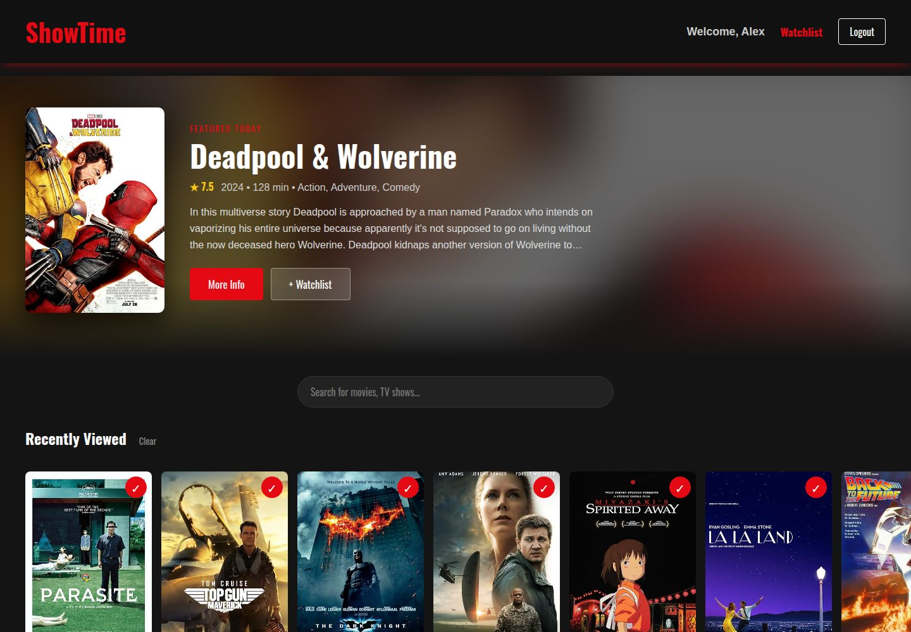
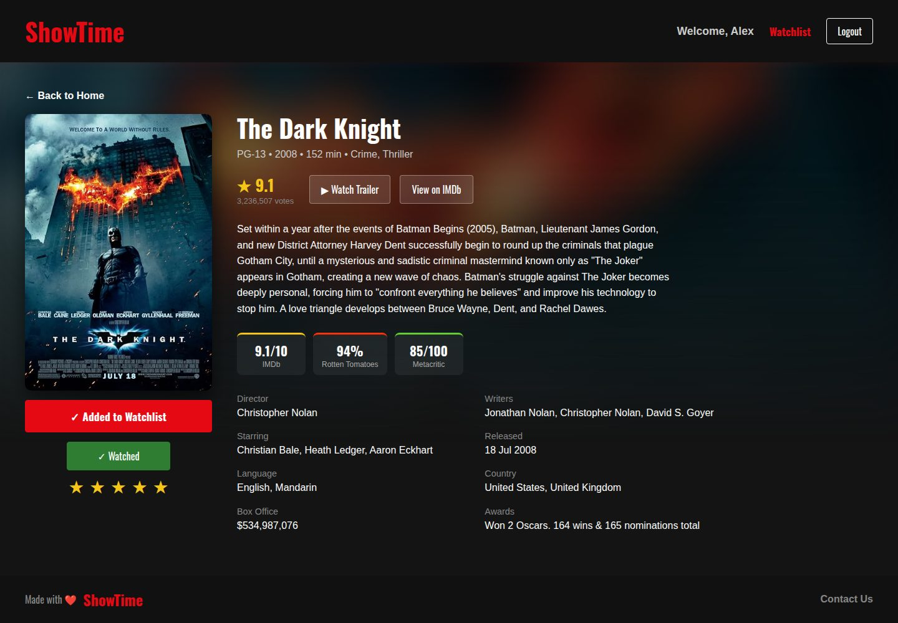
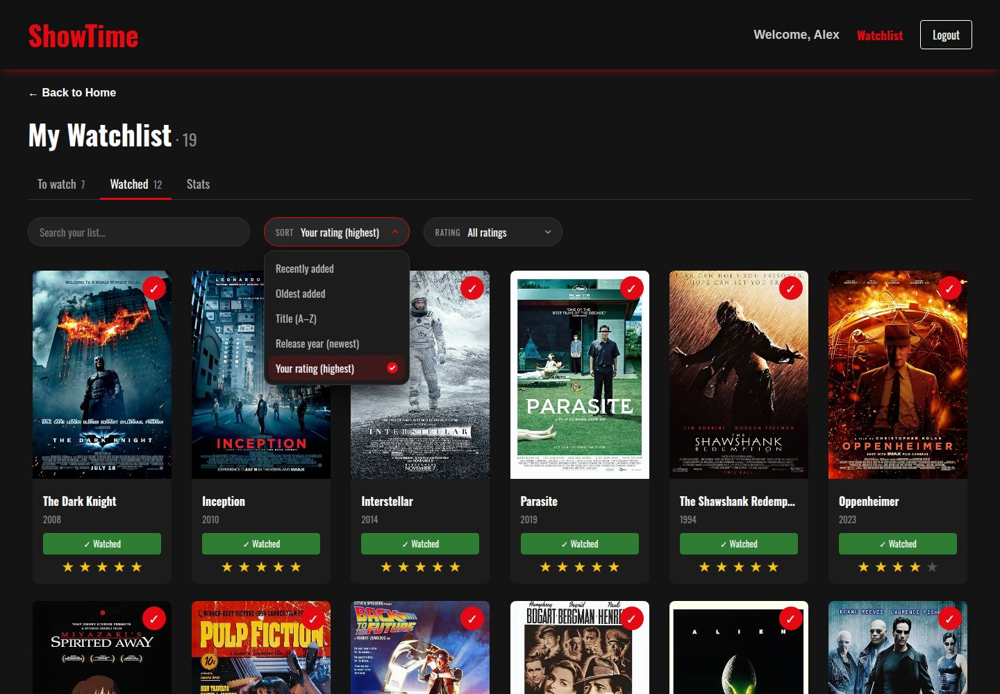
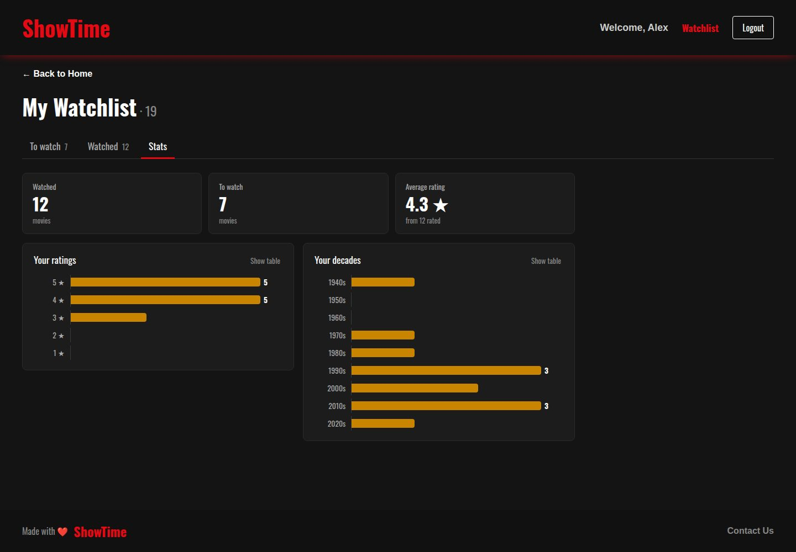
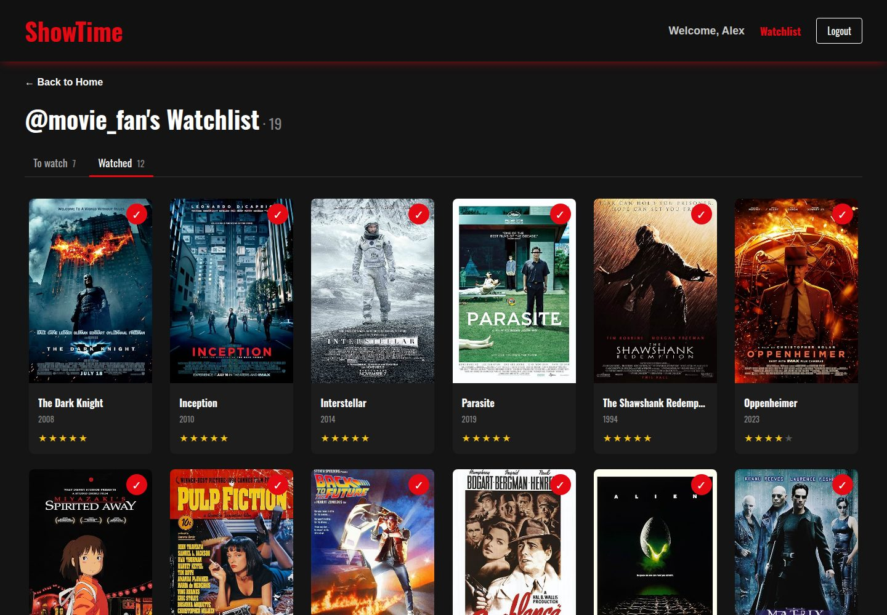
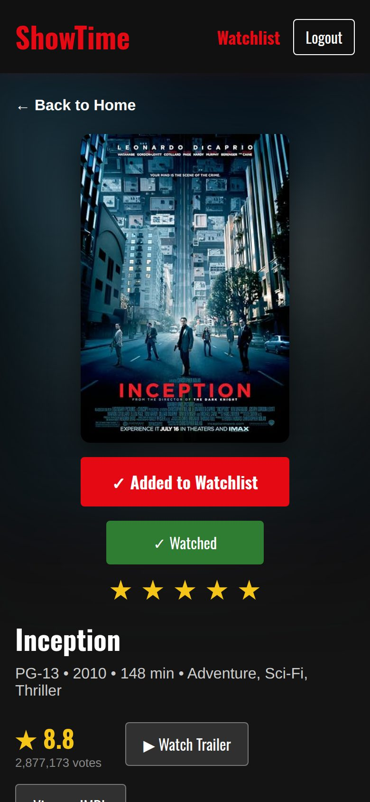
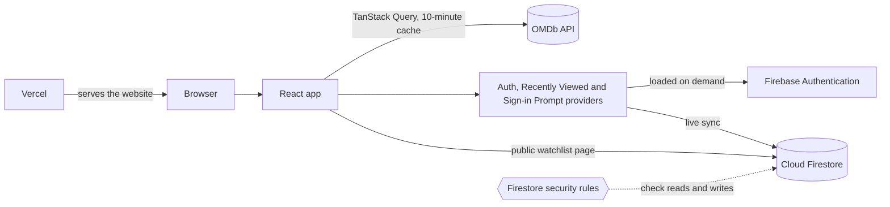
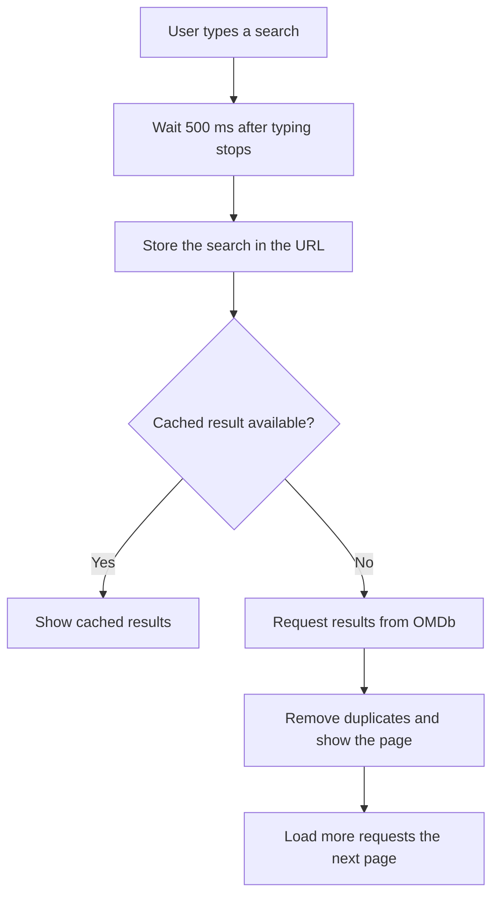
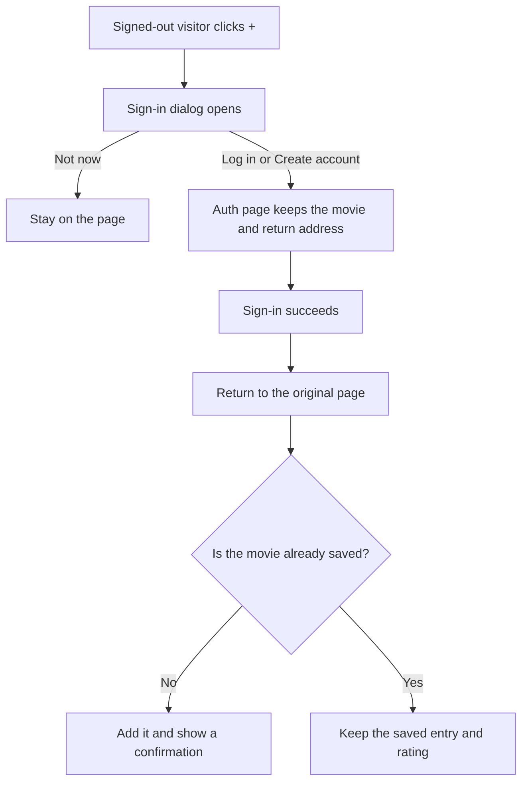
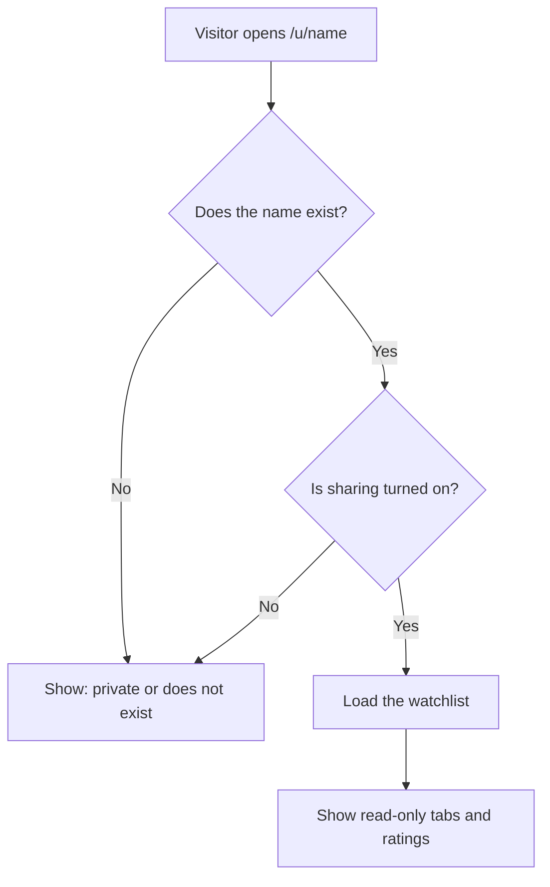

<div align="center">

# ShowTime

**Find your next movie, keep track of what you watch, and share your taste with friends.**

### [Try ShowTime →](https://show-time-chi.vercel.app/)

Free to use · Nothing to install · No account needed to browse

[What you can do](#what-you-can-do) · [Screenshots](#screenshots) · [Questions](#quick-questions) · [Built with](#built-with) · [Architecture](#architecture) · [Run it locally](#run-it-locally)



</div>

## What you can do

### Find something to watch

- See a new **featured movie** every day.
- Browse rows of **latest movies, action, romantic comedies, thrillers, comedies, family movies, crowd pleasers and animation**.
- **Search as you type**, and narrow results to movies or series.
- Pick up where you left off with **Recently Viewed**.

### Decide if it's worth your time

- Compare **IMDb, Rotten Tomatoes and Metacritic** scores, when available.
- Read the plot and see the runtime, genre, age rating and IMDb vote count.
- Check the **director, writers, cast, release date, language, country, box office and awards**.
- Use **Watch Trailer** to find the trailer on YouTube, or **View on IMDb** for more detail.

### Keep track of your movies

- Save a movie to your **watchlist** with one click from a poster, the featured banner or its movie page.
- Mark movies as **watched** and give them **1 to 5 stars**.
- Use the **To watch** and **Watched** tabs to keep your list organized.
- **Search your list**, sort it by date added, title, release year or your rating, and filter it by stars.
- Sign in with **email or Google**, and your watchlist follows you across devices.

### Discover your taste

- See how many movies you have watched and still want to watch.
- Check your **average rating** and how your ratings are spread.
- Find out **which decades** you watch most.

### Share your list

- Create your own link, such as `/u/movie_fan`.
- Friends can see your lists and ratings **without creating an account**.
- Turn sharing off or change your link whenever you want.

## Screenshots

| Everything about a movie | Your watchlist |
|---|---|
|  |  |

| Your movie stats | A list you can share |
|---|---|
|  |  |

<p align="center">
  
  <br>
  <em>Made to work on phones too.</em>
</p>

## Quick questions

**Is ShowTime free?**
Yes.

**Do I need an account?**
No. You can browse, search and open movie pages without one. You only need an account to save movies, rate them and share a list.

**Can I watch full movies here?**
No. ShowTime helps you discover and keep track of movies. **Watch Trailer** opens a YouTube search for the trailer.

**Who can see my watchlist?**
Only you, unless you turn on sharing. Anyone with your link can then see your lists and ratings. Your Recently Viewed history stays private.

**Where does the movie information come from?**
Movie details, posters and scores come from the [OMDb API](https://www.omdbapi.com/), so some details may be missing for some titles.

## Built with

| Area | Tools |
|---|---|
| Interface | React 19, React Router 7, CSS |
| Movie data | OMDb API, Axios, TanStack Query |
| Accounts and saved data | Firebase Authentication, Cloud Firestore |
| Build and code quality | Vite 7, ESLint, Vitest, React Testing Library |
| Hosting and automation | Vercel, GitHub Actions |

## Architecture

ShowTime is a single-page React app with no custom backend. The browser gets movie data from OMDb and talks directly to Firebase for accounts and saved data. Firestore security rules decide what each person can read or change.



Some choices that shape the app:

- **Fast first load:** the homepage ships first. Other pages and Firebase download when they are needed.
- **Shareable views:** search terms, tabs, sorting and filters live in the URL, so Back, refresh and shared links keep them.
- **Fewer API calls:** OMDb responses are cached for 10 minutes.
- **Browsing keeps working:** without Firebase settings, movie pages and search still run and account features turn off clearly.

### Searching



### Saving a movie before signing in



### Opening a shared watchlist



## Project structure

```
src/
├── api/          OMDb client and public watchlist loader
├── components/   Movie cards and rows, dropdowns, ratings, charts, sharing and sign-in dialog
├── context/      Auth and watchlist, Recently Viewed and sign-in prompt providers
├── hooks/        Debounced input, share settings and watchlist button behavior
├── lib/          Firebase loader, stats, sharing, history and sign-in error helpers
├── pages/        Home, movie, watchlist, public watchlist, login, signup, contact and 404
└── test/         Shared test setup and helpers
rules-tests/      Firestore security rules tests
docs/screenshots/ Images used in this README
firestore.rules   Database security rules
```

## Run it locally

### What you need

- **Node.js 20.19+ or 22.12+**
- A free [OMDb API key](https://www.omdbapi.com/apikey.aspx)
- A free [Firebase project](https://console.firebase.google.com), only if you want accounts and watchlists

### 1. Install

```bash
git clone https://github.com/Rishikapurbey/ShowTime.git
cd ShowTime
npm install
cp .env.example .env.local
```

### 2. Add your settings

Fill in `.env.local`:

| Variable | Required | Where to find it |
|---|---|---|
| `VITE_OMDB_KEY` | Yes | The key OMDb emails to you |
| `VITE_FIREBASE_API_KEY`<br>`VITE_FIREBASE_AUTH_DOMAIN`<br>`VITE_FIREBASE_PROJECT_ID`<br>`VITE_FIREBASE_STORAGE_BUCKET`<br>`VITE_FIREBASE_MESSAGING_SENDER_ID`<br>`VITE_FIREBASE_APP_ID` | For accounts | Firebase console → Project settings → Your apps → Web app |

### 3. Set up Firebase (optional)

1. Create a Firebase project and add a **Web app**.
2. In **Authentication → Sign-in method**, enable **Email/Password** and **Google**.
3. Create a **Firestore Database**.
4. Publish the included security rules:

   ```bash
   npx firebase-tools deploy --only firestore:rules --project <your-project-id>
   ```

### 4. Start the app

```bash
npm run dev
```

Open the address Vite prints, usually http://localhost:5173.

### Useful commands

| Command | What it does |
|---|---|
| `npm run dev` | Start the development server |
| `npm run build` | Create the production build |
| `npm run preview` | Preview the production build |
| `npm run lint` | Check the code with ESLint |
| `npm test` | Run the tests |

## Credits

Movie information and posters come from the [OMDb API](https://www.omdbapi.com/). Accounts and saved data use [Firebase](https://firebase.google.com/).

## Author

**Rishika Purbey** · [GitHub @Rishikapurbey](https://github.com/Rishikapurbey)
